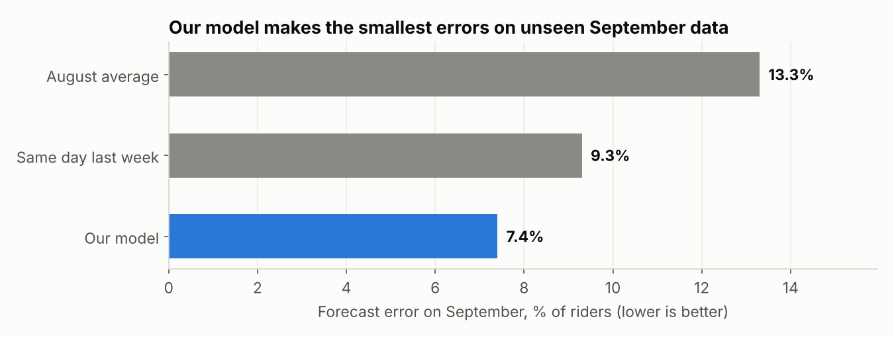
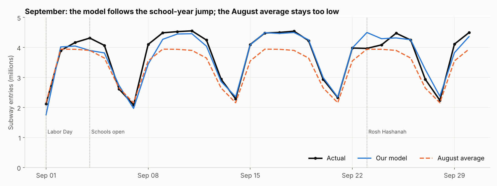

# Predicting Tomorrow's Subway Ridership at Every NYC Station

**NYC in Motion Datathon — Rutgers Data Science Club, Fall 2026**

## The problem
The MTA plans trains, station staff and cleaning crews for 424 subway station complexes every day. Rules of thumb like "same as last week" or "the usual average" break down whenever ridership shifts, such as on holidays, when schools reopen, or in bad weather. That leads to crowded stations in some places and wasted staff in others.

**Question:** Using only information available the day before, how accurately can we predict each station's entries for the next day, and does a model beat the simple rules of thumb?

## Approach
- **Data:** MTA daily station-complex entries plus NOAA daily weather (Central Park), Aug 1 – Sep 30, 2025.
- **Time-based split:** train on **August**, test on **September**. The model never sees September during training.
- **Model:** gradient-boosted trees (`HistGradientBoostingRegressor`). Inputs are day of week, holiday flag, rain, max temperature, yesterday's entries and the same day last week. It predicts *tomorrow ÷ the station's 7-day average*, so one model works for both small and huge stations.
- **Baselines to beat:**
  - A: the station's August average for that weekday
  - B: the same day last week

## Key results (September, unseen data)

| Method | Error (% of riders, WAPE) | Avg miss per station-day |
|---|---|---|
| August average | 13.3% | 1,173 entries |
| Same day last week | 9.3% | 824 entries |
| **Our model** | **7.4%** | **650 entries** |

- The model has **about 20% less error** than "same day last week" and **about 44% less** than "August average."
- **Weekday ridership rose 14% from August to September** (3.79M to 4.34M) when schools reopened on Sept 4. A fixed average misses that completely.
- Error is lowest in Manhattan (6.6%) and highest in the Bronx (9.7%).
- **Day of week and recent history** drive the forecast. Rain and temperature added almost nothing over two mild months.
- The biggest misses are **calendar events**: Labor Day, the first week of school, and Rosh Hashanah (Sept 23, when NYC public schools were closed).




## Recommendation
1. Use next-day station-level forecasts for staffing and service planning instead of fixed averages.
2. **Add the school calendar and holidays as model inputs.** They caused the largest errors, and the dates are known months ahead.
3. Retrain regularly so the model adapts to seasonal shifts.

## Limitations
- Only two months of data, with one holiday and no full seasonal cycle.
- MTA data counts **entries** only, not exits, crowding or delays.
- We used *observed* next-day weather. In practice the model would use a weather forecast.
- Weather comes from one station (Central Park) for the whole city.
- 44 of 25,864 station-days are missing in the source data and were left out of scoring.

## How to run
```bash
pip install -r requirements.txt
jupyter notebook ridership_forecast.ipynb   # then Run All (about 30 seconds)
```

## Files
```
ridership_forecast.ipynb   all analysis, model, charts
figures/                   charts saved by the notebook
data/public/               the two datasets used (from the datathon kit)
requirements.txt
```

## Data sources
- **MTA Subway Hourly/Daily Ridership** (station-complex daily entries), via data.ny.gov, provided in the datathon kit.
- **NOAA Global Historical Climatology Network – Daily**, Central Park station USW00094728, provided in the datathon kit.
- NYC public school calendar dates (Sept 4 first day; Sept 23–24 closed): NYC Department of Education 2025–26 school year calendar (schools.nyc.gov).

See the datathon's `DATA_SOURCES.md` for official links.
